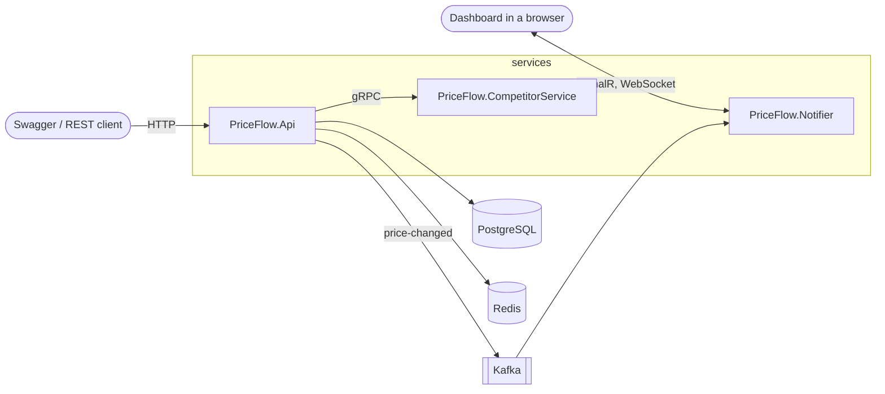

# PriceFlow

[](https://github.com/roma6kk/PriceFlow/actions/workflows/ci.yml)

A small dynamic pricing system. It keeps product prices slightly below a competitor's price, never lets them drop under cost plus a minimal margin, and streams every price change to a live dashboard.

I built it to practice the .NET backend stack on something closer to a real task than a todo list: several services, sync and async communication between them, a cache, a background job.

## How it works



1. A background worker in the API wakes up every 15 seconds and reprices the catalog.
2. It asks **CompetitorService** for competitor prices over **gRPC** (one server-streaming call for the whole catalog).
3. The domain calculates a new price for every product: 1% below the competitor, but not below `cost * (1 + minMargin)`.
4. Changed prices and history rows are saved to **PostgreSQL** in one transaction.
5. For every changed price the API drops the cached value in **Redis** and publishes a `price-changed` event to **Kafka**.
6. **Notifier** consumes the topic and pushes the event to browsers over **SignalR**.

The competitor service is a simulator: every SKU gets a stable base price that drifts within 5%, so there is always something happening on the dashboard. SKUs that start with `EXCL-` are "own brand" products the competitor does not sell.

## Stack

- .NET 10, ASP.NET Core, C#
- MediatR (CQRS, pipeline behaviors, notifications), FluentValidation
- EF Core + PostgreSQL (Npgsql), migrations, optimistic concurrency on `xmin`
- gRPC (unary and server streaming)
- Kafka (Confluent.Kafka), Redis (cache-aside), SignalR
- xUnit, NSubstitute
- Docker, docker compose, GitHub Actions, Husky.Net

## Project structure

The main service follows Clean Architecture: dependencies point inwards, the domain knows nothing about the database or the transport.

```
src/
  PriceFlow.Domain            entities and the pricing rule, no dependencies
  PriceFlow.Application       use cases: MediatR commands, queries, validators, interfaces
  PriceFlow.Infrastructure    EF Core, gRPC client, Kafka producer, Redis cache
  PriceFlow.Api               controllers, error handling, repricing worker
  PriceFlow.Contracts         .proto file and the Kafka message, shared between services
  PriceFlow.CompetitorService gRPC server with simulated competitor prices
  PriceFlow.Notifier          Kafka consumer + SignalR hub + dashboard page
tests/
  PriceFlow.UnitTests         domain and handler tests
```

CompetitorService and Notifier are single projects on purpose: they are too small to be worth splitting into layers.

## Running

You only need Docker.

```bash
docker compose up --build
```

| What | URL |
|---|---|
| Swagger UI | http://localhost:5080/swagger |
| Live dashboard | http://localhost:5082 |
| Health check | http://localhost:5080/health |

The API applies migrations on startup and, in the Development environment, adds five demo products. Open the dashboard and wait for the next repricing run, rows will start to appear and update.

To run the services from the IDE instead, start only the infrastructure:

```bash
docker compose up postgres redis kafka kafka-init
```

PostgreSQL is published on port `5434` so it does not clash with a local installation.

## API

| Method | Route | Description |
|---|---|---|
| GET | `/api/products` | All products with current and competitor prices |
| GET | `/api/products/{id}` | One product |
| POST | `/api/products` | Create a product |
| PUT | `/api/products/{id}/cost` | Change cost and minimal margin, the price is recalculated |
| POST | `/api/products/{id}/reprice` | Reprice one product right now |
| GET | `/api/products/{id}/price-history` | Latest price changes |
| GET | `/api/prices/{sku}` | Current price by SKU, cached in Redis |

Ready-made requests are in [PriceFlow.Api.http](src/PriceFlow.Api/PriceFlow.Api.http).

Errors come back as problem details: `400` for validation, `404`, `409` for a duplicate SKU or a concurrent update, `422` for a broken business rule.

## Development

```bash
dotnet tool restore      # dotnet-ef and husky
dotnet husky install     # git hooks
dotnet test
```

Git hooks:

- `pre-commit` runs `dotnet format` on staged files
- `commit-msg` checks the message against Conventional Commits
- `pre-push` builds the solution and runs the tests

Adding a migration:

```bash
dotnet ef migrations add <Name> -p src/PriceFlow.Infrastructure -s src/PriceFlow.Api -o Persistence/Migrations
```

CI runs on every push and pull request: formatting check, build, tests, then Docker images for all three services. From `main` the images are pushed to GitHub Container Registry.
